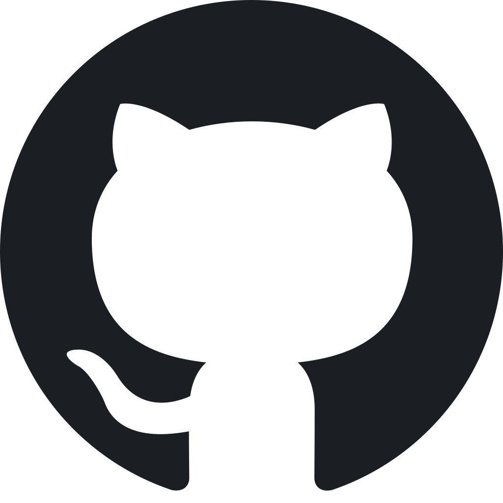

# 🎬 Сценарий - Урок 4: Цикл `for`


---

## Бесплатный курс по программированию на C++

Всем привет! Это самый лёгкий, бесплатный и подробный курс по языку программирования C++. Если вы давно хотели начать его изучать - сейчас самое время.

---

## Вступление

В прошлом уроке мы научили программу принимать решения с помощью `if` и `else`. Но что, если нам нужно вывести числа от 1 до 1000? Писать тысячу раз `std::cout`?  Хотя если вы разработчик <a href="https://ru.wikipedia.org/wiki/Yandere_Simulator">Yandere Simulator</a> то возможно вы и напишите все через `if else`, но есть способ гарздо прощечеи написания этих ~3.5 к строк.

Сегодня мы начинаем большую тему - **циклы**. В C++ есть **три типа циклов**:
1. `for` - сегодняшний урок
2. `while` - следующий урок
3. `do-while` - тоже в следующем уроке

Сегодня разберём **первый тип** - цикл `for`. Это самый популярный цикл, когда мы **заранее знаем**, сколько раз нужно повторить код.

---

## Что такое `for`

`for` - это цикл с **известным количеством повторений**. Внутри него собрано сразу три вещи: создание счётчика, условие продолжения и изменение счётчика. Всё в одной строке.

💡 **Главная идея:** `for` - это когда ты *знаешь*, сколько раз нужно что-то сделать.

---

## Синтаксис

```cpp
for (начало; условие; шаг) {
    // код, который повторяется
}
```

Три части разделены точкой с запятой `;`:

| Часть | Когда выполняется | Что обычно делают |
| --- | --- | --- |
| **Начало** | Один раз перед стартом | Создают счётчик (`int i = 0`) |
| **Условие** | Перед каждой итерацией | Проверяют, продолжать ли (`i < 10`) |
| **Шаг** | После каждой итерации | Меняют счётчик (`i++`) |

**Порядок работы:**
1. Выполняется `начало` (один раз)
2. Проверяется `условие`
   - Если `false` → цикл заканчивается
   - Если `true` → выполняется тело цикла
3. Выполняется `шаг`
4. Возврат к пункту 2

---

## Примеры

### Простой вывод чисел от 1 до 5

```cpp
for (int i = 1; i <= 5; i++) {
    std::cout << "Итерация номер " << i << std::endl;
}
// Выведет:
// Итерация номер 1
// Итерация номер 2
// Итерация номер 3
// Итерация номер 4
// Итерация номер 5
```

*Как это читается:* "Создай `i` равное 1. Пока `i <= 5`, выполняй код. После каждого выполнения увеличивай `i` на 1".

### Разбираем по шагам

| Шаг | `i` | Проверка `i <= 5` | Действие |
| --- | --- | --- | --- |
| 1 | Создаётся `i = 1` | `1 <= 5` → ✅ true | Вывод "Итерация 1", затем `i++` |
| 2 | `i = 2` | `2 <= 5` → ✅ true | Вывод "Итерация 2", затем `i++` |
| 3 | `i = 3` | `3 <= 5` → ✅ true | Вывод "Итерация 3", затем `i++` |
| 4 | `i = 4` | `4 <= 5` → ✅ true | Вывод "Итерация 4", затем `i++` |
| 5 | `i = 5` | `5 <= 5` → ✅ true | Вывод "Итерация 5", затем `i++` |
| 6 | `i = 6` | `6 <= 5` → ❌ false | **Цикл заканчивается** |

### Обратный отсчёт

```cpp
for (int i = 10; i >= 1; i--) {
    std::cout << i << " ";
}
// Выведет: 10 9 8 7 6 5 4 3 2 1
```

💡 Обрати внимание: используем `>=` и `i--` вместо `<=` и `i++`.

### Шаг больше 1

```cpp
for (int i = 0; i <= 20; i += 2) {
    std::cout << i << " ";
}
// Выведет: 0 2 4 6 8 10 12 14 16 18 20
```

💡 `i += 2` - это то же самое, что `i = i + 2`.

### Только нечётные

```cpp
for (int i = 1; i <= 20; i += 2) {
    std::cout << i << " ";
}
// Выведет: 1 3 5 7 9 11 13 15 17 19
```

### Отрицательные числа

```cpp
for (int i = -5; i <= 5; i++) {
    std::cout << i << " ";
}
// Выведет: -5 -4 -3 -2 -1 0 1 2 3 4 5
```

---

## `for` + `if` - мощное сочетание

В прошлом уроке мы изучили `if`. А теперь представь: **внутри цикла можно использовать `if`** - и это одна из самых частых конструкций в программировании!

### Вывести только чётные числа

```cpp
for (int i = 1; i <= 10; i++) {
    if (i % 2 == 0) {  // если число чётное
        std::cout << i << " ";
    }
}
// Выведет: 2 4 6 8 10
```

### Посчитать сумму только положительных чисел

```cpp
int sum = 0;
for (int i = -5; i <= 5; i++) {
    if (i > 0) {  // if внутри цикла!
        sum += i;
    }
}
std::cout << "Сумма положительных: " << sum << std::endl;  // 15
```

💡 **Главная идея:** Цикл перебирает много значений, а `if` внутри него решает - что делать с каждым конкретным значением.

---

## Управление циклом: `break` и `continue`

Иногда нужно вмешаться в работу цикла изнутри. Для этого есть две команды:

*   **`break`** - полностью останавливает и прерывает цикл.
*   **`continue`** - пропускает текущую итерацию и переходит к следующей.

### Пример с `break`:

```cpp
for (int i = 1; i <= 10; i++) {
    if (i == 5) {
        break;  // выйти из цикла, когда i станет 5
    }
    std::cout << i << " ";
}
// Выведет: 1 2 3 4
```

### Пример с `continue`:

```cpp
for (int i = 1; i <= 5; i++) {
    if (i == 3) {
        continue;  // пропустить тройку
    }
    std::cout << i << " ";
}
// Выведет: 1 2 4 5
```

💡 `break` и `continue` часто используются вместе с `if` - это стандартная практика.

---

## Область видимости переменной

Переменная, созданная в `начало` цикла `for`, **существует только внутри цикла**. После его окончания она исчезает.

```cpp
for (int i = 0; i < 5; i++) {
    std::cout << i << " ";
}
// std::cout << i;  // ❌ ОШИБКА! Переменной i здесь уже нет!
```

💡 Если тебе нужна переменная и после цикла - создай её **до** цикла:

```cpp
int i;  // создаём ДО цикла
for (i = 0; i < 5; i++) {
    std::cout << i << " ";
}
std::cout << "\nПосле цикла i = " << i;
```

---

## Вложенные циклы

Цикл может находиться **внутри другого цикла**. Внешний цикл выполняется N раз, а внутренний - M раз **на каждой итерации внешнего**. Итого будет N × M повторений.

### Пример: таблица умножения

```cpp
for (int i = 1; i <= 3; i++) {          // внешний цикл
    for (int j = 1; j <= 5; j++) {      // внутренний цикл
        std::cout << i << " * " << j << " = " << i * j << "\t";
    }
    std::cout << std::endl;  // переход на новую строку
}
```

**Вывод:**
```
1 * 1 = 1    1 * 2 = 2    1 * 3 = 3    1 * 4 = 4    1 * 5 = 5
2 * 1 = 2    2 * 2 = 4    2 * 3 = 6    2 * 4 = 8    2 * 5 = 10
3 * 1 = 3    3 * 2 = 6    3 * 3 = 9    3 * 4 = 12   3 * 5 = 15
```

💡 Переменные в вложенных циклах **должны называться по-разному** (`i` и `j`), иначе они будут конфликтовать.

---

## Скобки - обязательно

Как и в `if`, если в цикле только одна строка, скобки можно не писать. Но **не пиши так никогда**! Это путь к багам.

```cpp
// Плохо:
for (int i = 0; i < 5; i++)
    std::cout << i; 
    std::cout << "Привет";  // Это выполнится только 1 раз ПОСЛЕ цикла!

// Хорошо:
for (int i = 0; i < 5; i++) {
    std::cout << i; 
    std::cout << "Привет";
}
```

**Всегда пиши фигурные скобки для циклов** - так же, как и для `if`.

---

## Бесконечный цикл `for`

Все три части можно опустить - получится бесконечный цикл:

```cpp
for (;;) {
    std::cout << "Я буду работать вечно!" << std::endl;
}
```

💡 **Лайфхак:** Если ты случайно создал бесконечный цикл и программа зависла - не паникуй. В терминале нажми `Ctrl + C`, а в среде разработки нажми кнопку **Stop** (красный квадрат).

---

## Таблица - типичные задачи с `for`

| Задача | Код |
| --- | --- |
| Вывести числа от 1 до 100 | `for (int i = 1; i <= 100; i++)` |
| Вывести числа от 100 до 1 | `for (int i = 100; i >= 1; i--)` |
| Только чётные от 0 до 20 | `for (int i = 0; i <= 20; i += 2)` |
| Только нечётные от 1 до 20 | `for (int i = 1; i <= 20; i += 2)` |
| Сумма чисел от 1 до N | `for (int i = 1; i <= N; i++) sum += i;` |
| Факториал числа N | `for (int i = 1; i <= N; i++) fact *= i;` |

---

## Типичные ошибки

| Ошибка | Что происходит |
| --- | --- |
| Забыть изменить счётчик | Бесконечный цикл, программа зависает |
| Ошибка на единицу (`<` вместо `<=`) | Цикл выполнится на 1 раз меньше, чем ты ожидал |
| Менять счётчик внутри тела | `for (int i=0; i<5; i++) { i = 10; }` - это ломает логику цикла |
| `for (i = 0; i = 5; i++)` | Присваивание вместо сравнения. Условие всегда `true` |
| Забыть `;` между частями | Ошибка компиляции. Нужно ровно две точки с запятой |
| Использовать `i` после цикла | Переменная `i` создана внутри `for` и недоступна снаружи |
| Одинаковые имена во вложенных циклах | `for (int i...) { for (int i...) }` - ошибка, переменная уже существует |
| `for` без фигурных скобок | Только следующая строка в блоке, остальные выполнятся всегда |

---

## 📝 Задание к уроку 4

Напиши программу, которая:
1. Считывает целое число `N` с клавиатуры.
2. С помощью цикла `for` выводит на экран все числа от `1` до `N`.
3. Считает и выводит **сумму** всех этих чисел.
4. *Дополнительно:* внутри цикла с помощью `if` выводит слово `"Fizz"` вместо числа, если оно делится на 3, и `"Buzz"`, если делится на 5. Если делится и на 3, и на 5 - выводит `"FizzBuzz"`.

*Подсказка:* 
* Используй цикл `for`.
* Создай переменную `sum` **до** цикла и приравни её к `0`.
* Внутри цикла добавляй к ней текущее число: `sum = sum + i;` (или `sum += i;`).
* Для FizzBuzz используй несколько `if` внутри цикла (вспомни урок 3!).
* Проверка на делимость: `i % 3 == 0`.
* После завершения цикла выведи `sum` на экран.

---

## Итог

На сегодня всё! Мы разобрали:
* Что такое цикл `for` и зачем он нужен (когда известно количество повторений).
* Синтаксис с тремя частями: `начало`, `условие`, `шаг`.
* Разные варианты: обратный отсчёт, шаг больше 1, отрицательные числа.
* Область видимости переменной-счётчика.
* **Как сочетать `for` и `if`** - это основа большинства алгоритмов.
* Зачем нужны `break` (выход) и `continue` (пропуск).
* Вложенные циклы.
* Почему фигурные скобки в циклах обязательны.
* Как остановить зависшую программу (Ctrl+C).
* Типичные ошибки и как их избежать.

В следующем уроке мы изучим **два других типа циклов** - `while` и `do-while`. Они нужны, когда количество повторений заранее неизвестно, а зависит от условия. А цикл `for`, который мы прошли сегодня, станет главным инструментом для работы с массивами, которые мы разберём позже!

Если осталось что-то непонятным - спрашивай в Telegram:

 Канал: <a href="https://t.me/hellsfrik">@hellsfrik</a>
 Чат: <a href="https://t.me/programmer_chatik">@programmer_chatik</a>
 Discord сервер: <a href="https://discord.gg/rcPgU8GGFC">humanistik crew</a>
 GitHub: <a href="https://github.com/L1ghtsitte/FreePlusPlus">FreePlusPlus</a>

До следующего урока. 👋

```